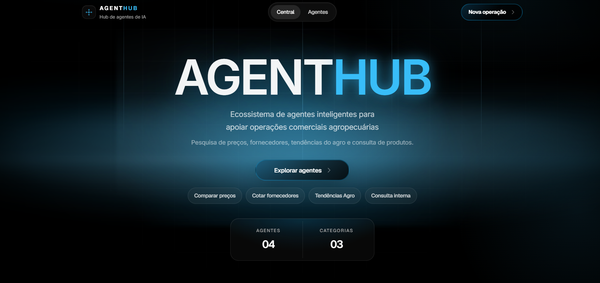
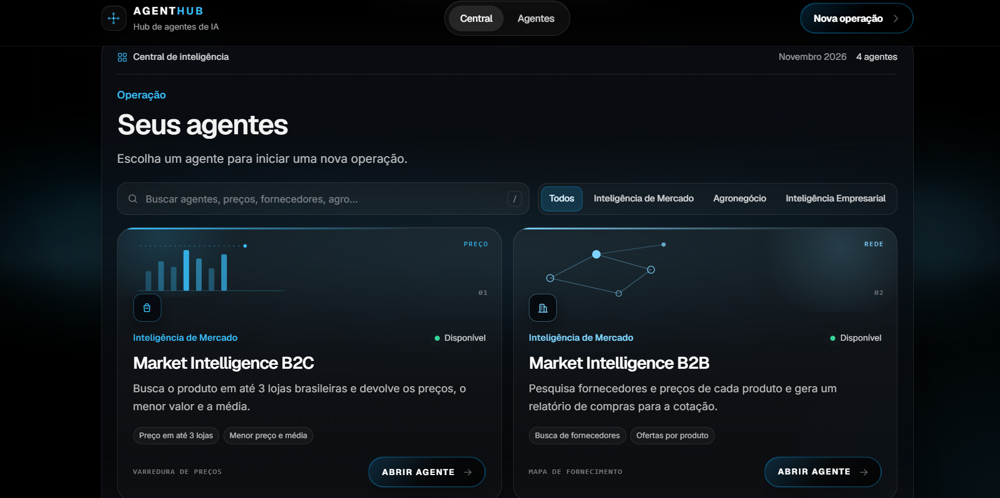
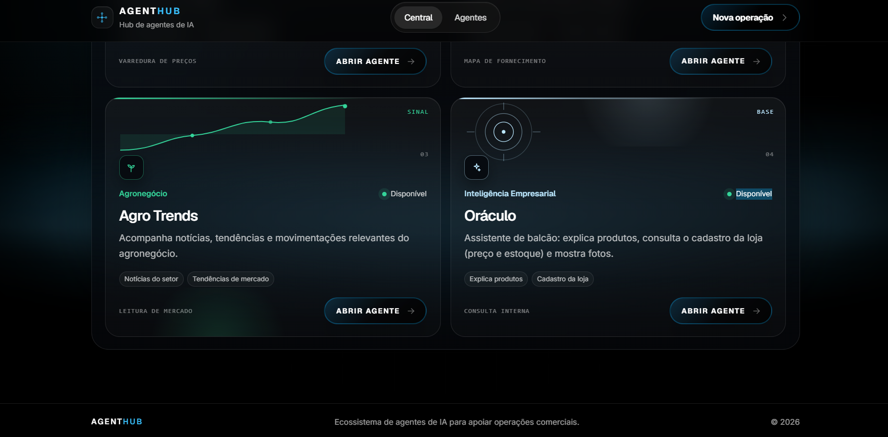
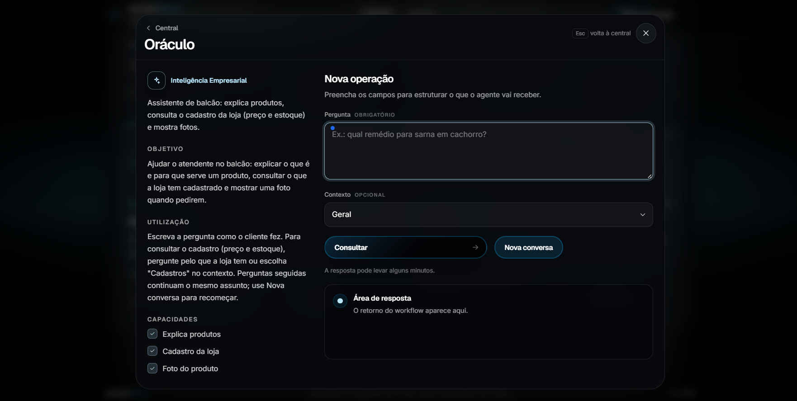

# AgentHub



Central com quatro workflows de agentes, servidos pelo [AgentOS](https://docs.agno.com) do Agno. Uma página única (`/hub`) lista os agentes, recebe o pedido e mostra a resposta. Não há uma API separada: o navegador fala direto com o servidor que o próprio Agno sobe.

## Os workflows

Na central (`Seus agentes`), cada workflow aparece como um card. Filtre por categoria ou busque pelo nome e clique em **Abrir agente** para iniciar uma operação.





| Card | Id | O que faz | Documentação |
| --- | --- | --- | --- |
| Market Intelligence B2C | `market-b2c` | Busca o produto em até 3 lojas brasileiras e devolve os preços, o menor valor e a média. | [backend/price](backend/price/README.md) |
| Market Intelligence B2B | `market-b2b` | Pesquisa fornecedores e preços de uma lista de produtos e gera o relatório de compras. | [backend/price/agent_b2b](backend/price/agent_b2b/README.md) |
| Agro Trends | `agro-trends` | Pesquisa notícias do agro, confere em pelo menos 3 fontes e devolve a leitura da tendência. | [backend/agro_trends](backend/agro_trends/README.md) |
| Oráculo | `oraculo` | Assistente de balcão: explica produtos, consulta o cadastro da loja (preço e estoque) e mostra fotos. | [backend/oracle](backend/oracle/README.md) |

Cada pasta tem um README com um print da tela do agente, o fluxo passo a passo, os agentes, as regras de validação e os limites conhecidos.

## Como funciona

```
Navegador (/hub)  ──►  AgentOS  ──►  Workflow  ──►  Agentes + ferramentas
  frontend/index.html    backend/main.py    passos em Python e agentes Gemini
```

1. A página `frontend/index.html` junta os campos do formulário num único texto (`buildMessage`).
2. Envia `POST /workflows/{id}/runs` com o formulário `message` e `stream=false`. O Oráculo também envia `session_id`.
3. O AgentOS, em `backend/main.py`, entrega o texto ao workflow com o mesmo id.
4. A página mostra o campo `content` da resposta.

### Padrão dos workflows

Os quatro seguem a mesma ideia: **o modelo pesquisa e escreve, o código decide e calcula.**

- Passos de preparação, contagem, filtros, médias e roteamento são funções Python.
- Os agentes usam ferramentas que validam a entrada (URL real, preço maior que zero, loja não repetida).
- Loops têm limite de voltas e uma condição de parada baseada em dados (3 lojas, 3 fontes, 2 ofertas por item).
- Cada agente segue uma **skill** (`SKILL.md`) com as regras do seu trabalho. No B2C e no Oráculo o texto da skill entra direto nas instruções do agente, o que poupa uma chamada ao modelo. No B2B e no Agro Trends o agente a carrega durante a execução.

### Campos de contexto

Os campos extras do formulário (Mercado, Recorte, Contexto, Características, Fornecedores) chegam ao workflow como texto no pedido. Hoje poucos têm efeito direto:

| Campo | Efeito |
| --- | --- |
| Oráculo, Contexto = `Cadastros` | Muda o caminho do workflow para a consulta ao cadastro. |
| B2C, Características | O texto é lido pelas regras de embalagem (ex.: "500 g", "por kg"). |
| B2B, Fornecedores | São pesquisados primeiro. |
| B2C Mercado, Agro Recorte, Oráculo Contexto (demais opções) | Só texto para o modelo. |

## Estrutura do projeto

```
AgentHub/
├── backend/
│   ├── main.py                  Sobe o AgentOS e entrega a página em /hub
│   ├── price/
│   │   ├── agent_b2c.py         Workflow market-b2c
│   │   ├── agent_b2b/
│   │   │   └── b2b_workflow.py  Workflow market-b2b
│   │   ├── skills/              b2c-varejo, b2b-pesquisa, b2b-relatorio
│   │   └── windows_certs.py     Ajuste de certificados (só Windows com antivírus)
│   ├── agro_trends/
│   │   ├── agro_trends_agent.py Workflow agro-trends
│   │   ├── skills/              pesquisa, apuração e validação
│   │   └── windows_certs.py     Mesmo ajuste, usado pelo Agro Trends
│   └── oracle/
│       ├── oracle_agent.py      Workflow oraculo
│       ├── loja_db.py           Consulta somente leitura ao ERP (SQLite)
│       └── skills/              nomes-populares, resposta-balcao
├── frontend/index.html          Página do hub (HTML, CSS e JS num arquivo)
├── docs/img/                    Prints usados nos READMEs
├── .env.example
└── pyproject.toml
```

## Como rodar

Requisitos: Python 3.12 ou superior e [uv](https://docs.astral.sh/uv/).

1. Copie `.env.example` para `.env` e preencha as chaves (tabela abaixo).
2. Na raiz do AgentHub:

```bash
uv sync
uv run python -m backend.main
```

3. Abra http://127.0.0.1:7777/hub
4. A API do AgentOS fica em http://127.0.0.1:7777/docs

### Variáveis do `.env`

| Variável | Obrigatória | Usada por |
| --- | --- | --- |
| `GOOGLE_API_KEY` | Sim | Todos os workflows (modelo Gemini). |
| `TAVILY_API_KEY` | Agro: sim. B2C e B2B: opcional | Busca na web. Sem a chave, B2C e B2B usam a busca do Agno. |
| `ORACLE_SQLITE_PATH` | Para consultar o cadastro | Oráculo: caminho do `erp.db`. |
| `ORACLE_STORE_ID` | Para consultar o cadastro | Oráculo: id da loja na tabela `stores`. |

O Oráculo busca na web pelo DuckDuckGo e não precisa de chave para isso.

## Exemplo de uso

Ao abrir um agente, a página mostra o objetivo, a utilização e as capacidades dele, ao lado do formulário da operação. No exemplo abaixo, o Oráculo espera a pergunta do atendente, um contexto opcional (`Geral` ou `Cadastros`) e devolve a resposta na área de resposta. O botão **Nova conversa** zera o histórico.



## Limites conhecidos

- **Uma execução por vez no B2C e no B2B.** As listas de ofertas e fornecedores ficam em memória do processo e são zeradas a cada pesquisa.
- **Agro e B2B podem levar vários minutos.** A resposta só chega ao final da execução, porque a página não usa streaming (`stream=false`).
- **O relatório do B2B** é salvo em `backend/price/agent_b2b/output/` (ignorado pelo git). O texto exibido na página depende do que o último agente responder.
- **Catálogos do B2B** vêm da pasta `backend/price/agent_b2b/catalogos/`. A página não faz upload.
- **Histórico do Oráculo** fica em memória e some quando o servidor reinicia.
- **Windows com antivírus que intercepta HTTPS (ex.: Avast):** o antivírus troca o certificado das conexões e o Python pode recusá-las ou até encerrar. Os `windows_certs.py` (em `backend/price` e `backend/agro_trends`) resolvem isso fazendo o Python usar os certificados do Windows, e o Oráculo aplica o mesmo ajuste dentro do `oracle_agent.py`. É um ajuste só para Windows: em Linux e macOS os `windows_certs.py` não fazem nada, e o projeto roda sem ele.
- Preço de site, catálogo ou web é referência, não cotação firme.

## Desenvolvimento

- Cada workflow roda sozinho no terminal, sem o servidor (comando no README de cada pasta). Isso ajuda a testar um fluxo isolado.
- Para um novo agente: crie o workflow em `backend/`, carregue e registre em `backend/main.py` e adicione o card na lista `AGENTS` do `frontend/index.html`.
