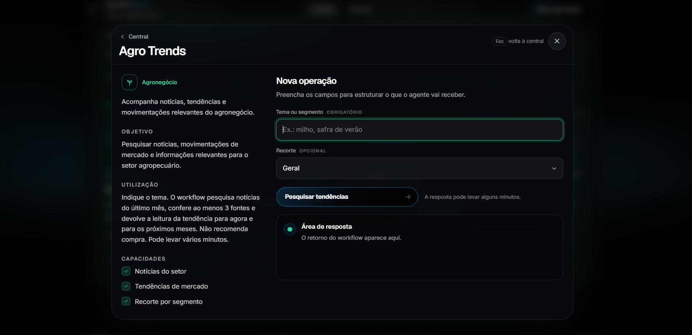

# Agro Trends

Workflow `agro-trends`. Pesquisa notícias do agronegócio sobre um tema, confere em várias fontes e devolve a **leitura da tendência**: o que está em curso agora e o que as fontes sustentam para os próximos meses.

Código: [`agro_trends_agent.py`](agro_trends_agent.py) · Skills: [`skills/`](skills)

> O `windows_certs.py` desta pasta é um ajuste de certificados só para Windows com antivírus que intercepta HTTPS (veja o [README do projeto](../../README.md#limites-conhecidos)). Em outros sistemas ele não faz nada.

## Exemplo de uso

Ao abrir o agente na central, informe o tema ou segmento (obrigatório) e, se quiser, um recorte. Clique em **Pesquisar tendências**. A resposta só aparece no fim e pode levar vários minutos.



## O que faz

1. **Pesquisa**: encontra a tendência principal do tema.
2. **Apuração**: busca a mesma tendência em outras fontes e monta um dossiê. Repete até haver pelo menos 3 fontes.
3. **Validação**: separa sinal de ruído, resolve contradições e escreve a leitura final.

O workflow **não recomenda compra, preço ou estoque** e **não grava arquivo**. A resposta do último passo é o resultado. Pode levar vários minutos.

## Entrada

O front envia o tema e, opcionalmente, um recorte:

```
milho, safra de verão. Recorte: Grãos
```

O recorte (Geral, Grãos, Proteína animal, Insumos, Clima e safra, Logística) é só texto no primeiro passo. Nenhum código o interpreta.

## Estrutura

```
pesquisa ──► apuracao_loop ──► validacao
(agente)     até 3 voltas       (agente)
             até 3 fontes
```

| Passo | Agente | Skill | O que entrega |
| --- | --- | --- | --- |
| `pesquisa` | Pesquisador Agro | `pesquisa-tendencias-agro` | Título, resumo, driver (clima, pragas, commodities, insumos, sazonalidade, regulamentação, tecnologia), fonte, palavras-chave e categorias impactadas. |
| `apuracao_loop` | Apurador de Fontes Agro | `apuracao-fontes-agro` | Dossiê com fontes coletadas, linha do tempo, pontos de consenso, contradições, sinal e lacunas. |
| `validacao` | Validador de Tendência Agro | `validacao-tendencia-agro` | Fatos confirmados, disputados e não verificados, a leitura (agora e próximos meses) e um bloco RESUMO com veredito e confiança. |

### O loop de apuração

- Máximo de 3 voltas (`MAX_TENTATIVAS_APURACAO`).
- Para quando `fontes_suficientes` conta pelo menos 3 fontes (`MIN_FONTES`) na seção `## FONTES COLETADAS` do dossiê. Cada fonte é uma linha `- **Veículo**: Título (URL)` ou uma URL distinta.
- Se faltarem fontes, a instrução manda buscar outras, como Embrapa, Conab, MAPA, Cepea e Canal Rural.

### Busca

- Ferramenta: Tavily (`web_search_using_tavily` e `extract_url_content`). **Exige `TAVILY_API_KEY`.**
- Configuração: tópico `news`, janela de **1 mês**, profundidade `basic`.
- Regra de todos os agentes: só citar URL, título e data que a ferramenta devolveu. Nada inventado. Busca vazia leva a uma consulta mais curta.

### Modelo

Gemini (`gemini-3.5-flash-lite`), com limite de 8.000 tokens de saída.

## Veredito da validação

O bloco RESUMO fecha a resposta com um destes vereditos:

| Veredito | Significa |
| --- | --- |
| `TENDÊNCIA REAL` | Confirmada por fontes sólidas e com continuidade no tempo. |
| `SINAL FRACO` | Possível tendência, com lacunas relevantes. |
| `RUÍDO/HYPE` | Menção isolada, especulação ou dado sem corroboração. |

Junto vêm a confiança (alto, médio, baixo), o que pode e o que não pode ser afirmado, e o que ficou em aberto.

## Rodar sozinho

Na raiz do projeto, com `GOOGLE_API_KEY` e `TAVILY_API_KEY` no `.env`:

```bash
uv run python backend/agro_trends/agro_trends_agent.py
```

O script roda um tema de exemplo e imprime a resposta em streaming.
