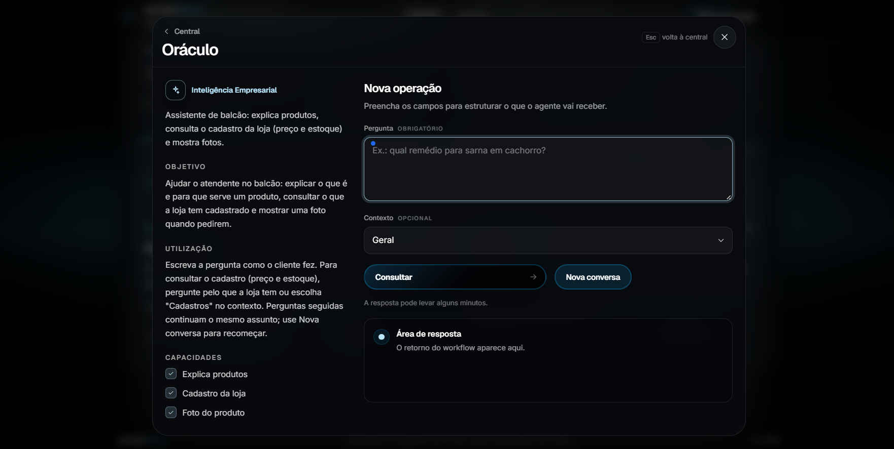

# Oráculo

Workflow `oraculo`. Assistente de balcão para uma loja agro: ajuda o atendente a entender o que o cliente pediu, consulta o que a loja tem cadastrado e mostra uma foto quando pedirem.

Código: [`oracle_agent.py`](oracle_agent.py) e [`loja_db.py`](loja_db.py) · Skills: [`skills/`](skills)

## Exemplo de uso

Ao abrir o agente na central, escreva a pergunta como o cliente fez e escolha o contexto (`Cadastros` leva à consulta ao ERP). Clique em **Consultar**. Perguntas seguidas continuam o mesmo assunto; **Nova conversa** recomeça do zero.



## O que faz

| Tipo de pergunta | Exemplo | O que acontece |
| --- | --- | --- |
| Sobre um produto | "o que é proteinado?" | Traduz o nome popular para o técnico, pesquisa na web e explica: o que é, para que serve, como usar e o que perguntar ao cliente. |
| Sobre o cadastro da loja | "tenho sulfato de cobre?" | Consulta o ERP (só leitura) e responde com nome, preço e estoque do que a loja tem. |
| Pedido de foto | "mostra uma foto" | Depois da explicação, busca uma imagem, confere se o link abre e anexa à resposta. |

Em saúde animal, o Oráculo cita nomes comerciais e princípios ativos que a busca trouxe, mas **não inventa dose, via ou intervalo** e deixa claro que o tratamento é decisão do veterinário.

## Estrutura

```
                  ┌─ cadastro ──► consultar_loja
rota (Condition) ─┤
                  └─ produto ───► identificar_produto (Loop) ──► responder ──► foto
```

| Passo | Tipo | O que faz |
| --- | --- | --- |
| `rota` | `Condition` | `_pergunta_de_cadastro` decide o caminho. |
| `consultar_loja` | agente | Responde com os dados do ERP. Só chama como "da loja" o que veio das ferramentas. |
| `identificar_produto` | `Loop` (máx. 2) | O agente `identificar` descobre o produto e responde com `BUSCA_OK` quando conseguiu. Se a busca ficar vaga, tenta de novo com outro termo. |
| `responder` | agente | Monta a resposta no formato da skill `resposta-balcao`. |
| `foto` | função | `anexar_foto_se_pediu` busca e anexa a imagem, só se o atendente pediu. |

### Como a rota decide

`_pergunta_de_cadastro` olha **só a pergunta atual** (o histórico não conta) e segue para o cadastro quando:

- o formulário veio com `Contexto: Cadastros`; ou
- a pergunta tem pistas de estoque ou cadastro, como "cadastrado", "ERP", "no estoque", "na loja", "temos", "tenho", "vendemos".

Na dúvida, segue o caminho de produto.

> O campo "Contexto" do front chega ao workflow como a linha `Contexto: ...` no começo da mensagem. Hoje só `Cadastros` muda o caminho. Geral, Operacional, Comercial e Financeiro são apenas texto para o modelo.

### Agentes

Todos usam Gemini (`gemini-3.5-flash-lite`).

| Agente | Ferramentas | Skill |
| --- | --- | --- |
| `identificar` | `web_search` | `nomes-populares` |
| `responder` | `web_search` | `resposta-balcao` |
| `consultar_loja` | `listar_categorias_da_loja`, `buscar_produtos_da_loja`, `listar_produtos_da_categoria`, `web_search` | nenhuma (instruções no agente) |

As skills `nomes-populares` e `resposta-balcao` são lidas dos `SKILL.md` na inicialização (função `ler_skill`) e entram direto nas instruções do `identificar` e do `responder`, sem chamada extra ao modelo para carregá-las. O modelo tem retry curto (até 3 novas tentativas, esperando 3, 6 e 12 s) para erros temporários.

A busca na web usa DuckDuckGo (`ddgs`), sem chave.

### Consulta ao cadastro (`loja_db.py`)

- Abre o banco SQLite do ERP com `mode=ro` e `PRAGMA query_only`, então **nada é gravado**.
- Lê só a tabela `products`, e só da loja configurada em `ORACLE_STORE_ID`.
- A busca ignora acento e maiúsculas e tolera plural simples ("fertilizantes" acha "fertilizante"). Nome pesa mais que categoria, e categoria mais que descrição.
- Cada produto traz nome, descrição, categoria, preço, unidade e estoque.
- Estoque "não controlado no sistema" quer dizer que a loja não registra a quantidade. O agente nunca deve tratar isso como produto em falta.
- Quando a pergunta é "qual dos que tenho serve para X", o agente busca no cadastro, confere a espécie do produto (cão e gato não recebem produto de grande animal) e confirma a indicação na web quando a descrição está vazia.

### Foto

`buscar_imagem` pesquisa imagens no DuckDuckGo, descarta resultados que não combinam com o assunto (por exemplo, camiseta no lugar de ferramenta) e só usa um link que realmente abre como imagem. Sem foto válida, o texto segue sem imagem e a resposta avisa.

## Conversa contínua

O workflow guarda o histórico em memória (`InMemoryDb`, só a última execução entra como contexto). O front gera um `session_id` na primeira pergunta e o reutiliza nas seguintes, então perguntas seguidas mantêm o assunto ("e a foto disso?"). O botão **Nova conversa** descarta esse `session_id`, e a próxima pergunta começa do zero. Recarregar a página também zera a conversa. O histórico some quando o servidor reinicia.

## Configuração

No `.env`, além de `GOOGLE_API_KEY`:

| Variável | Para quê |
| --- | --- |
| `ORACLE_SQLITE_PATH` | Caminho do `erp.db`. |
| `ORACLE_STORE_ID` | Número da loja na tabela `stores`. |

Sem elas, as perguntas sobre cadastro respondem que não conseguiram ler o cadastro. As perguntas sobre produto continuam funcionando.

## Rodar sozinho

Na raiz do projeto:

```bash
uv run python backend/oracle/oracle_agent.py
```

Abre um chat no terminal. Enter vazio encerra.
