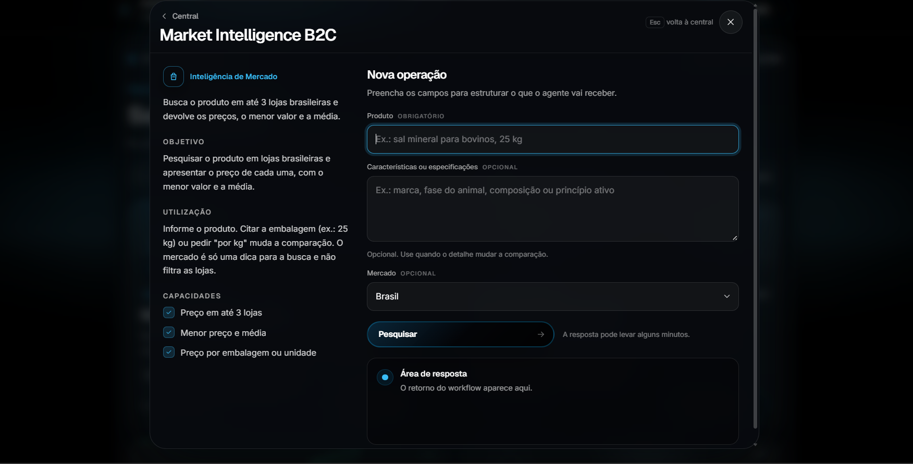

# Market Intelligence B2C

Workflow `market-b2c`. Pesquisa o preço de um produto em lojas brasileiras e devolve a lista de lojas com o **menor preço** e a **média**.

Código: [`agent_b2c.py`](agent_b2c.py) · Skill: [`skills/b2c-varejo`](skills/b2c-varejo/SKILL.md)

> Esta pasta também guarda o [B2B](agent_b2b/README.md). As skills de B2C e B2B ficam juntas em `skills/`. O `windows_certs.py` é compartilhado pelos dois: é um ajuste de certificados só para Windows com antivírus que intercepta HTTPS (veja o [README do projeto](../../README.md#limites-conhecidos)).

## Exemplo de uso

Ao abrir o agente na central, a página mostra o objetivo e a utilização dele, ao lado do formulário. Preencha o produto (obrigatório), as características e o mercado (opcionais) e clique em **Pesquisar**. O resultado aparece na área de resposta.



## O que faz

1. Recebe o pedido em texto (ex.: `café em grãos, 500 g. Características: torra média. Mercado: Brasil`).
2. Um agente busca o produto na web e registra cada preço encontrado numa lista temporária.
3. A busca repete até haver preço em **3 lojas diferentes** ou até **3 tentativas**.
4. O Python monta a resposta final. **Nenhuma conta é feita pelo modelo**: menor preço, média e filtros de embalagem são calculados no código.

Exemplo de saída:

```
café em grãos, 500 g. Mercado: Brasil

- Loja A: R$ 32,90 por 500 g
  https://...
- Loja B: R$ 29,50 por 500 g
  https://...
- Loja C: R$ 35,00 por 500 g
  https://...

Menor: R$ 29,50 por 500 g — Loja B
Média: R$ 32,47 por 500 g
```

## Estrutura

```
preparar ──► coleta_de_precos (Loop) ──► organizar_ofertas
 (Python)      até 3 lojas ou 3 voltas        (Python)
```

| Passo | Tipo | O que faz |
| --- | --- | --- |
| `preparar` | função | Zera a lista de ofertas da pesquisa anterior e repassa o texto do pedido. |
| `coleta_de_precos` | `Loop` (máx. 3) | Em cada volta chama `coletar_precos_b2c`. O loop para quando `ofertas_b2c_suficientes` vê 3 lojas diferentes. |
| `coletar_precos_b2c` | função + agente | Se a meta já foi atingida, não faz nada. Senão chama o agente `b2c_price_collector` com o pedido e a lista de lojas já registradas, para ele não repetir. |
| `organizar_ofertas` | função | Chama `montar_resumo` e devolve o texto final. |

### O agente coletor

- Modelo: Gemini (`gemini-3.5-flash-lite`).
- Ferramentas de busca: Tavily, se `TAVILY_API_KEY` existir; senão, `WebSearchTools` (sem chave).
- Ferramenta de escrita: `registrar_oferta`.
- Instruções: as regras da skill `b2c-varejo` entram direto nas instruções do agente (o `SKILL.md` é lido na inicialização, sem chamada extra ao modelo para carregá-la) e ele faz no máximo duas buscas por volta.
- Retry: até 3 novas tentativas em erro temporário do Gemini, esperando 5, 10 e 20 s.

### `registrar_oferta`: o que a ferramenta recusa

A validação está no código, não só na instrução do modelo:

- preço ou quantidade menores ou iguais a zero;
- URL que não começa com `http`;
- equivalência fora de `identico`, `equivalente` ou `parcial`;
- URL já registrada ou loja já registrada. Duas páginas da mesma loja contam como uma fonte.

### Como o resumo é calculado (`montar_resumo`)

| O pedido diz | O resumo faz |
| --- | --- |
| Nada de especial | Compara as lojas que vendem a **mesma embalagem** mais comum. As outras aparecem em "Fora da média, porque a embalagem é outra". |
| Uma embalagem (`10 comprimidos`, `15 kg`) | Só entra na média quem vende essa embalagem (tolerância de 5%). |
| Preço unitário (`por kg`, `por litro`, `por comprimido`, `unitário`) | Converte tudo para a unidade base (kg, L ou un) e compara por unidade. |

Gramas viram quilo e mililitros viram litro antes da comparação. Com menos de 3 lojas, o resumo avisa: `Meta de 3 lojas: achamos N`.

## Limites conhecidos

- A lista de ofertas fica em memória do processo. Rode **uma pesquisa de cada vez**.
- Preço de site é referência: muda com região, frete, estoque e promoção. O campo "Mercado" do front entra só como texto do pedido e **não filtra** lojas.
- O texto inteiro do pedido (produto, características e mercado) é lido pelas regras de embalagem. Por isso citar "500 g" em qualquer campo influencia a comparação.

## Rodar sozinho

Na raiz do projeto, com a `GOOGLE_API_KEY` no `.env`:

```bash
uv run python backend/price/agent_b2c.py
```

O script pergunta o produto no terminal e imprime o resumo.
