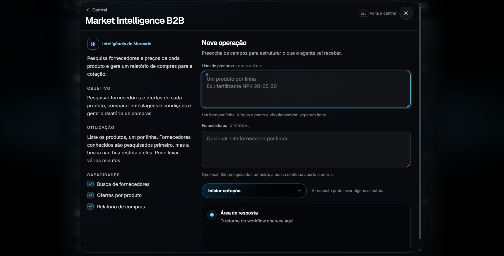

# Market Intelligence B2B

Workflow `market-b2b`. Pesquisa fornecedores e preços de uma lista de produtos, junta tudo num dossiê e gera o **relatório de compras** em Markdown.

Código: [`b2b_workflow.py`](b2b_workflow.py) · Skills: [`../skills/b2b-pesquisa`](../skills/b2b-pesquisa/SKILL.md) e [`../skills/b2b-relatorio`](../skills/b2b-relatorio/SKILL.md)

## Exemplo de uso

Ao abrir o agente na central, preencha a lista de produtos (um por linha, obrigatória) e, se quiser, os fornecedores preferenciais. Clique em **Iniciar cotação** e aguarde: a resposta só aparece no fim e pode levar vários minutos.



## O que faz

1. Lê a lista de produtos e, se houver, os fornecedores preferenciais.
2. Lê os catálogos (PDF e imagem) colocados na pasta `catalogos/`.
3. Uma equipe de agentes pesquisa **fornecedores** e **preços** na web e nos catálogos.
4. Para cada produto que ficou com poucas ofertas, repete a busca de preços.
5. O Python organiza fornecedores e ofertas num dossiê com avisos de qualidade.
6. Um agente analisa o dossiê e outro salva o relatório final.

O workflow pode levar vários minutos.

## Entrada

O front envia um texto com dois blocos:

```
Produtos:
fertilizante NPK 20-05-20
ração para bovinos 25 kg

Fornecedores:
Cooperativa X
```

- `Produtos:` é obrigatório. Itens separados por linha, vírgula ou ponto e vírgula. Por causa da vírgula, evite usá-la dentro do nome de um produto.
- `Fornecedores:` é opcional. São pesquisados **primeiro**, mas a busca não fica restrita a eles.
- Texto sem os rótulos é tratado como lista de produtos.
- Sem nenhum produto, o workflow para com a mensagem "Informe pelo menos um produto."

## Estrutura

```
preparar ──► pesquisa_inicial ──► complementar_precos (Loop) ──► dossie ──► analise ──► relatorio
 (Python)     (Team: 2 agentes)     até 2 voltas                 (Python)    (agente)    (agente)
```

| Passo | Tipo | O que faz |
| --- | --- | --- |
| `preparar` | função | Zera fornecedores e ofertas, interpreta o pedido, lê os catálogos e monta o pedido completo que os agentes recebem. |
| `pesquisa_inicial` | `Team` (modo `coordinate`) | Coordena `supplier_collector_agent` (fornecedores) e `price_collector_agent` (preços). Primeiro os fornecedores, depois os preços. |
| `complementar_precos` | `Loop` (máx. 2) | Chama o coletor de preços só para os produtos com menos de 2 ofertas. Para quando todos atingem a meta. |
| `dossie` | função | `montar_dossie` organiza fornecedores, ofertas por produto (da mais barata para a mais cara) e avisos. |
| `analise` | agente | `analyst_agent` compara as ofertas, sem buscar na web. |
| `relatorio` | agente | `report_agent` escreve o relatório e salva com `save_file`. |

### Agentes e ferramentas

| Agente | Ferramentas | Papel |
| --- | --- | --- |
| `supplier_collector_agent` | busca web + `registrar_fornecedor` | Acha fabricantes, distribuidores e cooperativas. Loja e marketplace só como complemento. |
| `price_collector_agent` | busca web + `registrar_oferta` | Registra preço, embalagem e condições, na web ou no catálogo. |
| `analyst_agent` | nenhuma | Compara só o que está no dossiê. |
| `report_agent` | `FileTools` | Salva `relatorio_compras_b2b.md`. |

Todos usam Gemini (`gemini-3.5-flash-lite`). A busca usa Tavily se `TAVILY_API_KEY` existir; senão, `WebSearchTools`.

### O que as ferramentas recusam

`registrar_oferta` valida no código:

- preço e quantidade maiores que zero;
- `item_solicitado` igual a um dos produtos do pedido;
- `tipo_fonte` igual a `web` ou `catalogo`;
- oferta da web com URL `http`; oferta de catálogo com arquivo e página em `referencia`;
- equivalência `identico`, `equivalente` ou `parcial`;
- a mesma fonte não entra duas vezes para o mesmo item.

`registrar_fornecedor` exige URL real e um tipo entre `fabricante`, `distribuidor`, `cooperativa`, `loja` e `marketplace`. Se o fornecedor já existe, atualiza.

Embalagens em gramas e mililitros são convertidas para kg e litro, para o preço unitário ser comparável.

### Avisos de qualidade do dossiê

O dossiê inclui avisos automáticos quando:

- um produto ficou com menos de 2 ofertas;
- todas as ofertas de um produto vêm só de catálogo;
- nenhum fabricante, distribuidor ou cooperativa foi encontrado (as fontes podem ser só varejo);
- um catálogo não pôde ser lido.

## Catálogos

Coloque os arquivos em `backend/price/agent_b2b/catalogos/`. A pasta é criada ao iniciar e está no `.gitignore`.

- **PDF:** o texto é extraído. PDF digitalizado, sem texto, gera aviso.
- **Imagem** (`png`, `jpg`, `jpeg`, `webp`, `bmp`): lida por OCR. Exige `pillow`, `pytesseract` e o Tesseract instalado, que **não** fazem parte das dependências do projeto. Sem eles, a imagem é ignorada com aviso.
- Limite de 20.000 caracteres por arquivo e 60.000 no total enviado aos agentes.

## Saída

- A resposta do workflow é o texto do último passo (`relatorio`).
- O relatório fica salvo em `backend/price/agent_b2b/output/relatorio_compras_b2b.md`. A pasta está no `.gitignore` e o arquivo é sobrescrito a cada execução.
- Preço de web ou catálogo é referência e precisa ser confirmado com o fornecedor. O relatório diz isso.

## Limites conhecidos

- Fornecedores e ofertas ficam em memória do processo. Rode **uma cotação de cada vez**.
- A resposta mostrada no front depende do que o `report_agent` escrever. A skill pede que ele confirme o nome do arquivo, então o texto completo pode ficar só no arquivo salvo.

## Rodar sozinho

Na raiz do projeto, com a `GOOGLE_API_KEY` no `.env`:

```bash
uv run python backend/price/agent_b2b/b2b_workflow.py
```

O script pergunta produtos e fornecedores no terminal.
